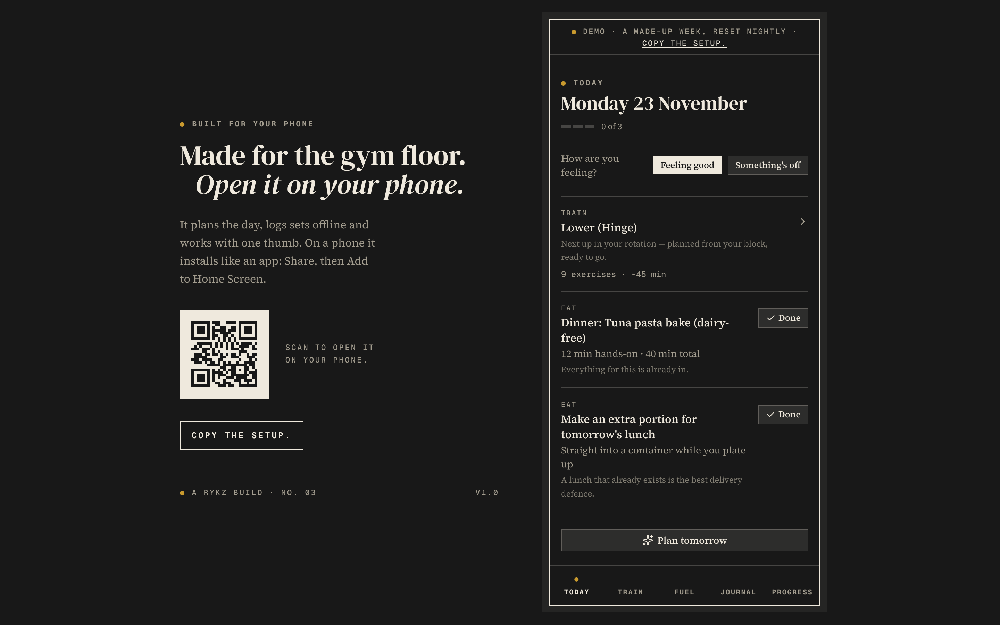
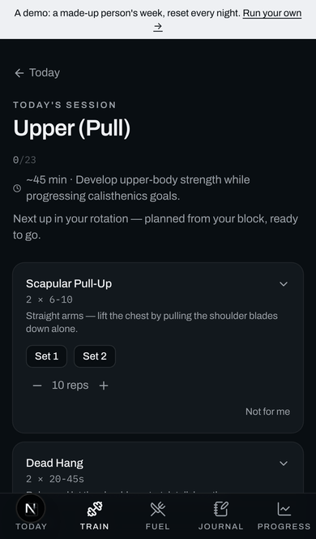
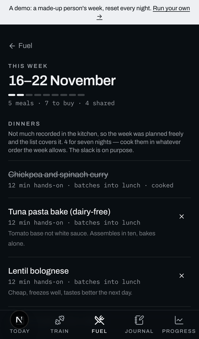
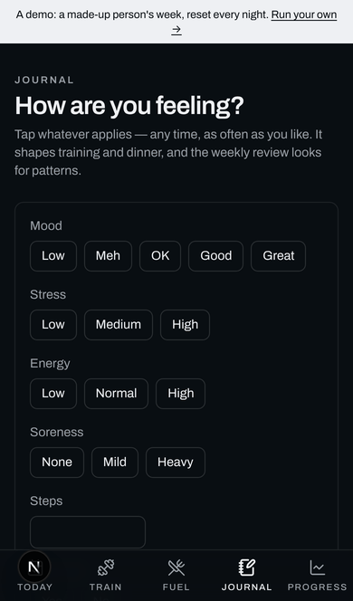

<sub>● A Rykz build · No. 03 · v1.0</sub>

# Project 365

A calm personal coach for training and food that you run yourself. It plans each day's session around how you feel, plans the week's meals around what's in your kitchen, and never makes you feel behind.

[](https://vercel.com/new/clone?repository-url=https%3A%2F%2Fgithub.com%2Frcxkz%2F365-coach&project-name=365-coach&repository-name=365-coach&stores=%5B%7B%22type%22%3A%22integration%22,%22integrationSlug%22%3A%22neon%22,%22productSlug%22%3A%22neon%22,%22protocol%22%3A%22storage%22%7D%5D)

**[Try the demo first](https://365-coach.vercel.app)** · [Get it working properly](#get-it-working-properly) · [Using an AI assistant?](#using-an-ai-assistant) · [How it works](docs/HOW_IT_WORKS.md)

## Deploy your own in five minutes

You need a free [GitHub](https://github.com/signup) account and a free [Vercel](https://vercel.com/signup) account. There's no coding, and it's free to run for one person.

1. **Click Deploy with Vercel** (above). Vercel copies this repo to your GitHub. If it says the name is taken, add your name to it, e.g. `365-coach-sam`.
2. **Add the database.** Under **Add Products → Storage** you'll see **Neon**. Click **Add**, then choose the free plan and the region closest to you.
3. **Click Deploy** and wait about a minute. There's nothing to type: the first build creates the database tables.
4. **Open your app straight away and choose a passcode.** The first screen asks for one, and it keeps your data private: nobody can open the app without it. Whoever chooses first claims the copy, so do it as soon as the deploy finishes.
5. **Tap Make it yours** (two minutes of taps), then **Plan today**.

That's a working coach. If anything is missing, the app shows a **Finish setting up** page that says exactly what to do, rather than an error.



## Get it working properly

The deploy above gives you everything on rules alone. These turn on the rest. Each one is an environment variable: in Vercel, open your project → **Settings → Environment Variables**, add it, then go to **Deployments → ⋯ → Redeploy**. **Changes only apply after a redeploy.**

| | What it gives you | What to add |
|---|---|---|
| **1. Put it on your phone** | Opens full screen like an app. | iPhone: open it in Safari → Share → **Add to Home Screen**. Android: Chrome → menu → **Add to Home screen**. |
| **2. The AI coach** | Sessions and meals planned by AI around your history, plus "describe a meal" drafting. Without it, the rules plan everything. | Your own API key: `ANTHROPIC_API_KEY` for Claude (the default), or another provider. See [The AI coach](#the-ai-coach). |
| **3. Morning planning** | The day is planned before you wake, without tapping **Plan today**. | `CRON_SECRET` = any long random text (a password manager's generator is fine). |
| **4. The morning notification** | One push between 7 and 8am saying what's on. Needs morning planning (3). | `VAPID_PUBLIC_KEY` and `VAPID_PRIVATE_KEY`. Make a pair with `npx web-push generate-vapid-keys`, or ask your AI assistant to. Then open **Settings** in the app and switch the reminder on. On iPhone, the app must be on your home screen (1). |
| **5. Your time zone** | Days start and end at your midnight, and the reminder comes at your 7am. | `APP_TIME_ZONE`, e.g. `America/New_York`. Outside the UK, also change the two hours in `vercel.json` (06:00 and 07:00 UTC) so one of them falls in your 7am hour. |

**Security:** the passcode is the lock. Change it in the app's **Settings → Passcode** and every other device is signed out, which is the way to lock out a lost phone. You can set it as `APP_PASSCODE` in Vercel instead, which takes over from the one chosen in the app.

## If something's not right

| What you see | What to do |
|---|---|
| **"Finish setting up"** | Follow the numbered steps on that page. Usually: connect the Neon database (Vercel → **Storage**), then redeploy. |
| **Forgot your passcode** | In Vercel, add `APP_PASSCODE` with a new passphrase and redeploy. It takes over from the forgotten one, and your data stays as it was. |
| **"A passcode was already chosen"** | Someone, probably you in another tab, chose it first. Unlock with that passcode, or use the line above to set a new one. |
| **"AI coaching isn't connected yet"** | No AI key is set, so it's planning on rules. Add one (see [The AI coach](#the-ai-coach)) and redeploy. |
| **"…out of credit"** | Your AI account needs topping up. The app plans on rules until it is. |
| **The day isn't planned in the morning** | Add `CRON_SECRET` and redeploy. On Vercel's free plan, each scheduled run happens at some point within its hour. |
| **No morning notification** | You need both VAPID keys and `CRON_SECRET`, the reminder switched on in **Settings**, and on iPhone the app added to your home screen. |
| **You changed a setting and nothing happened** | Environment variables only apply after a redeploy. |

## Using an AI assistant?

Paste the link to this repo into Claude, ChatGPT or any assistant, and it can walk you through all of the above. A good first message:

> Here's the repo for a personal coach app: https://github.com/rcxkz/365-coach. Read its README and AGENTS.md, then walk me through deploying my own copy to Vercel step by step, and then turning on the AI coach with my [Claude / ChatGPT / Gemini] key. Explain each step plainly, as I'm not a developer.

### For AI assistants

If a person asks you to help them set up or change this app, these are the facts to work from:

- **What it is:** a single-user Next.js (App Router) web app, deployed to Vercel, with a Neon Postgres database. It's one person per deployment, locked by a passcode. There's no sign-up system and no user accounts.
- **To deploy:** use the **Deploy with Vercel** button at the top of this README. It clones the repo and offers to create a Neon database (Add Products → Neon → Add). Nothing needs typing. The first production build runs `scripts/predeploy.ts`, which applies the database migrations and loads the exercise and meal libraries. Nothing needs running by hand.
- **The passcode:** on first open, the app asks the owner to choose one. It stores only a salted hash in their database (table `app_lock`), and they can change it in Settings. They should open the app right after deploying, because the first person to choose claims it. Setting `APP_PASSCODE` in Vercel overrides it, which is also how to recover a forgotten one.
- **Required environment:** only `DATABASE_URL`, which the Neon integration sets.
- **Optional environment:**
  - `ANTHROPIC_API_KEY`, or `OPENAI_API_KEY`, or `AI_API_KEY` + `AI_BASE_URL` + `AI_MODEL`;
  - `CRON_SECRET`;
  - `VAPID_PUBLIC_KEY` and `VAPID_PRIVATE_KEY` (optional `VAPID_SUBJECT`);
  - `APP_PASSCODE`, `APP_TIME_ZONE`, `AUTH_SECRET`, `AI_PROVIDER`, `AI_MODEL_FALLBACK`, `MAKER_STAMP`.
  - The [Environment](#environment) table explains each one.
- **Never set `DEMO_MODE` on a real deployment.** It's for the public demo: it turns AI off and lets a nightly job wipe and rebuild the data. (It also refuses to open the app without a passcode if one is set, but don't rely on that.)
- **Changing environment variables needs a redeploy** before it takes effect.
- **Run it locally:** `npm install && npm run dev`. That needs no database or passcode, because it uses an embedded database at `.data/pg`. Tests run with `npm test`.
- **Where things live:**
  - the look is in `src/theme/` (colours in `theme.css`, fonts in `fonts.ts`, the maker's stamp in `brand.ts`);
  - training plans are in `src/domain/templates.ts`;
  - the AI provider adapter is `src/ai/client.ts`;
  - the setup questions are in `src/app/setup/`.
- **Rules for changing the code:** read [AGENTS.md](AGENTS.md) first. In short:
  - `src/domain` stays pure, and `src/data` is the only layer that touches the database;
  - the app must keep working with no AI key (the rules-only fallback);
  - user-facing text stays calm, with no guilt language;
  - add tests alongside changes.

## What it does

- **Today:** one short list for the day: the session and the day's meals, saying which are prepped and which to cook tonight, with the prep session on prep day.
- **Train:**
  - **Planning:** sessions are planned from your chosen plan (five to pick from), equipment, session length and how you feel this morning.
  - **Logging:** one tap per set, and it works offline in the gym.
  - **Guides:** tap any exercise for start/finish photos and a demo link.
  - **Breaks:** if you're ill or take a break, pause. When you're back, the first three sessions ease you in.
- **Fuel:**
  - **Kitchen:** tap through what's in (in / running low / out).
  - **Week prep:** plans all seven days. For each meal you choose how often you cook it (say, quick breakfasts, lunch prepped twice, a different dinner every night), and it works out what's made when, around what you have. Every meal is 20 minutes hands-on or less, and the week's meals share ingredients where they can. Prepped food is planned to be eaten within three days, or frozen.
  - **Shopping:** one list grouped by aisle, made when you tap **Make my list**, so you can change the week first. Plan this week or next.
  - **Your meals:** add your own by hand, or describe one and let the AI fill it in.
- **Journal:** tap how you feel, plus anything you choose to track. High stress means a lighter session and an easier dinner, and the weekly review looks for patterns.
- **Weekly review:** "step up / repeat / ease off" for each exercise, with a short written summary.
- **Built for your phone:** full screen on a phone. On a desktop it runs in a phone-sized frame, with a QR code to open it on your phone.

<p>
  
  
  
  
</p>

### Principles

- **No guilt:** days a week is a limit, never a target, and nothing is ever "missed" or owed back.
- **The AI never blocks you:** it writes plans ahead of time, and if it's slow or unavailable, rules-based planning takes over. The app always has a plan.
- **Rules decide what's safe, the AI decides what's best:** pain, readiness, equipment and dietary rules filter the options in code before the AI picks among them.

## The AI coach

Your copy only ever uses accounts you add yourself: your own Vercel project, your own database, and your own AI key. Nothing connects back to the original.

The app was built and tuned on **Claude**, which is the default. It also runs on any provider that speaks OpenAI's chat format. Results on other models may vary. If a reply comes back unusable, the rules-based planner steps in, so nothing breaks.

In your Vercel project, open **Settings → Environment Variables**, add the lines for your provider, and redeploy:

| Provider | Environment variables |
|---|---|
| **Claude** (default) | `ANTHROPIC_API_KEY` = your key from the [Claude Console](https://console.anthropic.com). Runs on Claude Sonnet 5.5; set `AI_MODEL` to use another Claude model. |
| **ChatGPT / OpenAI** | `OPENAI_API_KEY` = your key from [platform.openai.com](https://platform.openai.com). Optional: `AI_MODEL` (default `gpt-5-mini`). |
| **Gemini** | `AI_API_KEY` = your key from [Google AI Studio](https://aistudio.google.com) · `AI_BASE_URL` = `https://generativelanguage.googleapis.com/v1beta/openai` · `AI_MODEL` = e.g. `gemini-2.5-flash` |
| **OpenRouter** (hundreds of models) | `AI_API_KEY` = your key from [openrouter.ai](https://openrouter.ai) · `AI_BASE_URL` = `https://openrouter.ai/api/v1` · `AI_MODEL` = e.g. `meta-llama/llama-3.3-70b-instruct` |
| **Groq** | `AI_API_KEY` · `AI_BASE_URL` = `https://api.groq.com/openai/v1` · `AI_MODEL` |
| **A local model** (running it on your own computer) | `AI_API_KEY` = anything · `AI_BASE_URL` = `http://localhost:11434/v1` (Ollama) · `AI_MODEL` = e.g. `llama3.2` |

Once a key is set, the plan button on Today says "Plan tomorrow with AI".

**Choosing a Claude model.** Set `AI_MODEL` to any Claude model and redeploy:

| `AI_MODEL` | Good for | Price per million tokens (in / out) |
|---|---|---|
| `claude-haiku-5-5` | The cheapest. Fine for picking meals; plans are simpler. | $0.10 / $0.50 |
| `claude-sonnet-5-5` *(default)* | The balance this app is tuned for. | $2 / $10 |
| `claude-opus-5-5` | More careful planning, for a little more. | $4 / $20 |
| `claude-fable-5-2` | Anthropic's most capable model. More than this app needs, at the top price. | $8 / $40 |

Prices are Anthropic's list prices in November 2026, so check the [current prices](https://www.anthropic.com/pricing). When the model you pick is rate limited, the app tries `AI_MODEL_FALLBACK` if you set one, and otherwise plans rules-only for that request.

**Good to know:**

- **API keys only.** A Claude Pro or Max subscription doesn't cover the API, and nor does ChatGPT Plus. Each is billed separately, pay as you go.
- **Keys stay with you.** They live in your Vercel settings and are never written into the code. If a key is missing or out of credit, the app says so on Today and plans rules-only.
- **Two keys set?** Claude is used. Set `AI_PROVIDER=openai` to use the other one.
- **Backup model.** `AI_MODEL_FALLBACK` names a second model to try when the first is rate limited.
- **Smaller models** follow the format less reliably. When a reply doesn't fit, that feature falls back to the rules for the day.

## Environment

| Variable | Needed for |
|---|---|
| `APP_PASSCODE` | Optional. Sets the passcode here instead of choosing it in the app, and takes over from an in-app one, which is how to recover a forgotten passcode. Use a passphrase, not a PIN. |
| `DATABASE_URL` | **Required, set for you** by the Neon database the Deploy button creates. Locally, leave it unset and the app uses a built-in database. |
| `CRON_SECRET` | Optional. Switches on the morning job: it plans the day before you wake and sends the reminder. Any long random text. |
| `VAPID_PUBLIC_KEY`, `VAPID_PRIVATE_KEY` | Optional. The morning push notification (needs `CRON_SECRET` too). Generate a pair with `npx web-push generate-vapid-keys`. `VAPID_SUBJECT` (e.g. `mailto:you@example.com`) is optional. |
| `ANTHROPIC_API_KEY`, or `OPENAI_API_KEY` / `AI_API_KEY` | Optional. Your own key for the AI coach: see [The AI coach](#the-ai-coach). `AI_BASE_URL`, `AI_MODEL`, `AI_MODEL_FALLBACK` and `AI_PROVIDER` fine-tune it. |
| `APP_TIME_ZONE` | Optional. Your time zone, e.g. `America/New_York`. Defaults to `Europe/London`. |
| `AUTH_SECRET` | Optional. Signs the login cookie. Without it, the cookie is signed with the database connection string, which is still a long secret only your server knows. |
| `MAKER_STAMP` | Optional. Set to `1` to show the maker's stamp in Settings. |
| `DEMO_MODE`, `PUBLIC_REPO_URL` | Only for the public demo. Never set `DEMO_MODE` on your own copy. |

## Make the look yours

The whole look lives in one folder, `src/theme/`:

| File | What it holds |
|---|---|
| `theme.css` | Every colour and the corner radius. Change the palette block at the top. |
| `fonts.ts` | The three typefaces (headings, text, figures). Any Google font works. |
| `brand.ts` | The small maker's stamp in Settings, hidden on your copy unless you set `MAKER_STAMP=1`. |

The rest of the app only uses names like `--background` and `--highlight`, never a colour value, and a test fails if one creeps in. Keep text at 4.5:1 contrast or better against your background.

The look it ships with is the Rykz Design DNA, dark version:

| | |
|---|---|
| Display | DM Serif Display, with Source Serif 4 for text and Geist Mono for labels and figures |
| Accent | Brass #C99A2E on ink #181818 |
| Mood | Calm, steady, unhurried |

It's one dark theme, with square edges and no shadows. Colour is kept for meaning: brass marks where you are, and the readiness dots are go, ease and stop.

## Run it locally

```bash
npm install
npm run dev     # http://localhost:3000, no database or passcode needed locally
npm test        # unit and end-to-end tests
npm run build
```

The stack is Next.js (App Router), TypeScript, Tailwind, Postgres via Drizzle (Neon in production, PGlite locally) and Claude via the Anthropic SDK, with an adapter for OpenAI-compatible providers (`src/ai/client.ts`). The layer rules are in [AGENTS.md](AGENTS.md) and each `src/*` folder's README.

To run the demo person (Alex, two weeks of made-up history) locally:

```bash
DEMO_MODE=1 npm run demo   # builds Alex in the local database
DEMO_MODE=1 npm run dev
```

## How it was built

Built with [Claude Code](https://claude.com/claude-code) from July to November 2026, in about 70 small, reviewed and tested steps. The story is in [the build log](docs/BUILD_LOG.md), and the design is in [How it works](docs/HOW_IT_WORKS.md).

## Licence

[MIT](LICENSE)
