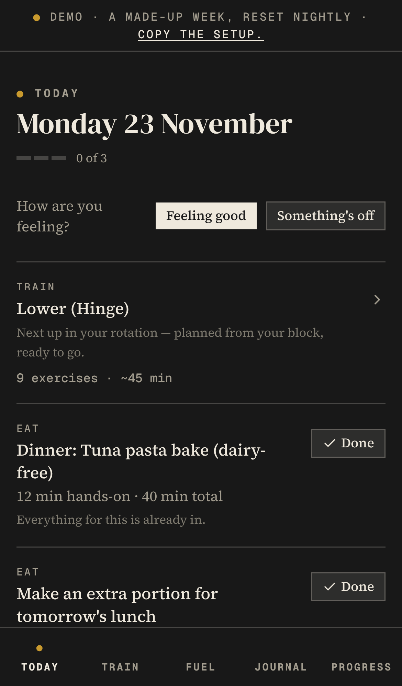

<sub>● A Rykz build · No. 03 · v1.0</sub>

# Project 365

A calm personal coach for training and food that you run yourself. It plans each day's session around how you feel, plans the week's meals around what's in your kitchen, and never makes you feel behind.

Built with [Claude Code](https://claude.com/claude-code): designed, written, tested and reviewed phase by phase. See [the build log](docs/BUILD_LOG.md).

**[Try the demo](https://365-coach.vercel.app)** · **[Deploy your own](#deploy-your-own)** · [How it works](docs/HOW_IT_WORKS.md)

<p>
  
  
  
  
</p>

## What it does

- **Today:** one short list for the day: the session, tonight's dinner, tomorrow's lunch.
- **Train:**
  - **Planning:** sessions are planned from your chosen plan, your equipment, your session length and how you feel this morning.
  - **Logging:** one tap per set, and it works offline in the gym.
  - **Guides:** tap any exercise for start/finish photos and a demo link.
  - **Breaks:** if you're ill or take a break, pause. When you're back, the first three sessions ease you in.
- **Fuel:**
  - **Kitchen:** tap through what's in (in / running low / out).
  - **Week plan:** plans the week's dinners and lunch preps around what you have.
  - **Shopping:** one shopping list grouped by aisle.
  - **Your meals:** add your own by hand, or describe one and let the AI fill it in.
- **Journal:** tap how you feel (mood, stress, energy, soreness, stomach) plus anything you choose to track. High stress means a lighter session and an easier dinner; the weekly review looks for patterns.
- **Weekly review:** "step up / repeat / ease off" for each exercise, with a short written summary.
- **Make it yours:** a two-minute setup covering your plan, days a week, equipment, areas to look after, dietary rules, household and which parts you want.

### Principles

- **No guilt:** days a week is a limit, never a target, and nothing is ever "missed" or owed back.
- **The AI never blocks you:** it writes plans ahead of time, and if it's slow or unavailable, rules-based planning takes over. The app always has a plan.
- **Rules decide what's safe, the AI decides what's best:** pain, readiness, equipment and dietary rules filter the options in code before the AI picks among them.

## Demo

The demo is a made-up person, Alex, with two weeks of history. It's open to everyone, resets every night, and runs rules-only (no AI). **→ [365-coach.vercel.app](https://365-coach.vercel.app)**

To run the demo locally:

```bash
npm install
DEMO_MODE=1 npm run demo   # builds Alex in a local database (PGlite, no setup)
DEMO_MODE=1 npm run dev    # http://localhost:3000
```

## Deploy your own

Your own app, your own database, your own data. One person per deployment, protected by a passcode.

[](https://vercel.com/new/clone?repository-url=https%3A%2F%2Fgithub.com%2Frcxkz%2F365-coach&env=APP_PASSCODE,AUTH_SECRET,CRON_SECRET&envDescription=A%20passcode%20to%20unlock%20the%20app%2C%20and%20two%20long%20random%20secrets&envLink=https%3A%2F%2Fgithub.com%2Frcxkz%2F365-coach%23environment)

1. Click the button. Vercel copies the repo to your GitHub and asks for three values (see [Environment](#environment)).
2. In the new Vercel project, open **Storage → Create → Neon Postgres** and connect it. That sets `DATABASE_URL`.
3. Redeploy. The first production build creates the database tables.
4. Open the app, unlock it with your passcode, and tap **Make it yours**.
5. Optional: add `ANTHROPIC_API_KEY` for the AI coach. Without it, everything still works rules-only.
6. Optional: on iPhone, open the site in Safari → Share → **Add to Home Screen**.

### Environment

| Variable | Needed for |
|---|---|
| `APP_PASSCODE` | The passcode you type to unlock the app. Use a passphrase, not a PIN. |
| `AUTH_SECRET` | Signs the login cookie. Any long random string: `openssl rand -base64 32`. |
| `CRON_SECRET` | Lets the scheduled morning job run. Another long random string. |
| `DATABASE_URL` | Set for you by Vercel's Neon integration. Unset locally, the app uses a built-in database. |
| `ANTHROPIC_API_KEY` | Optional. The AI coach ([get a key](https://console.anthropic.com)). |
| `APP_TIME_ZONE` | Optional. Your time zone, e.g. `America/New_York`. Defaults to `Europe/London`. |
| `MAKER_STAMP` | Optional. Set to `1` to show the maker's stamp in Settings. |
| `VAPID_PUBLIC_KEY`, `VAPID_PRIVATE_KEY` | Optional. The morning push reminder. Generate with `npx web-push generate-vapid-keys`. |

**Morning job timing:** `vercel.json` runs it at 06:00 and 07:00 UTC, which lands in the 7am hour in the UK all year round. For another time zone, change those two hours so one of them falls in your 7am hour. On Vercel's free plan each job runs at some point within its hour.

## Develop

```bash
npm install
npm run dev     # http://localhost:3000, no database setup needed
npm test        # unit and end-to-end tests
npm run build
```

The stack is Next.js (App Router), TypeScript, Tailwind, Postgres via Drizzle (Neon in production, PGlite locally) and Claude via the Anthropic SDK. The layer rules are in [AGENTS.md](AGENTS.md) and each `src/*` folder's README.

## Make the look yours

The whole look lives in one folder, `src/theme/`:

| File | What it holds |
|---|---|
| `theme.css` | Every colour and the corner radius. Change the palette block at the top. |
| `fonts.ts` | The three typefaces (headings, text, figures). Any Google font works. |
| `brand.ts` | The small maker's stamp in Settings, hidden on your copy unless you set `MAKER_STAMP=1`. |

The rest of the app only uses names like `--background` and `--highlight`, never a colour value, and a test fails if one creeps in. Keep text at 4.5:1 contrast or better against your background.

The look it ships with is the Rykz Design DNA, dark version:

| | |
|---|---|
| Display | DM Serif Display, with Source Serif 4 for text and Geist Mono for labels and figures |
| Accent | Brass #C99A2E on ink #181818 |
| Mood | Calm, steady, unhurried |

It's one dark theme, with square edges and no shadows. Colour is kept for meaning: brass marks where you are, and the readiness dots are go, ease and stop.

## Licence

[MIT](LICENSE)
